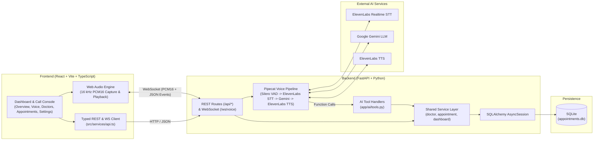
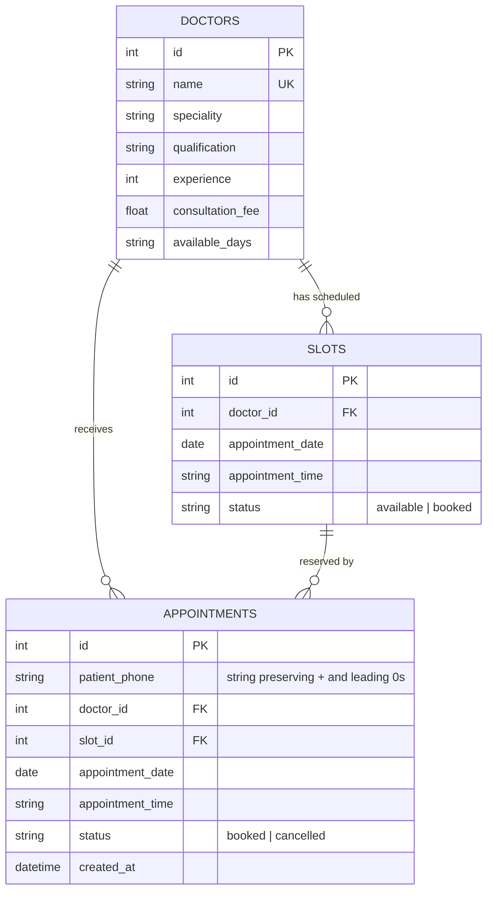

# Voice AI Doctor Appointment Assistant (CareFlow AI)

A real-time, voice-powered doctor appointment assistant and clinical scheduling dashboard built with **FastAPI**, **Pipecat**, **Google Gemini**, **ElevenLabs STT/TTS**, **SQLite**, and **React + TypeScript + Tailwind CSS**.

---

## Table of Contents

- [Project Overview](#project-overview)
- [Features](#features)
- [Technology Stack](#technology-stack)
- [Architecture](#architecture)
- [Voice Pipeline Explanation](#voice-pipeline-explanation)
- [Database Design](#database-design)
- [API Documentation](#api-documentation)
- [Project Folder Structure](#project-folder-structure)
- [Installation & Environment Setup](#installation--environment-setup)
- [Running the Application](#running-the-application)
- [Testing Instructions](#testing-instructions)
- [Documentation](#documentation)

---

## Project Overview

Patients can interact directly with **Maya**, an AI medical receptionist, through a live browser phone-call interface (`WebSocket /ws/voice`). Using natural speech, callers can inquire about doctor availability by speciality or date, book appointments after explicit phone number confirmation, and cancel existing bookings—with all state changes persisted atomically in **SQLite** and reflected immediately on the clinical dashboard.

---

## Features

### Voice AI Assistant (Pipecat + ElevenLabs + Gemini)
- Real-time bidirectional browser audio streaming over WebSocket (`16 kHz` mono Int16 PCM).
- Voice Activity Detection (**Silero VAD**) for natural turn-taking and barge-in interruption handling.
- Streaming Speech-to-Text (**ElevenLabs Realtime STT**) and natural Text-to-Speech (**ElevenLabs TTS**).
- Conversational reasoning and function calling (**Google Gemini**) backed directly by SQLite:
  - `check_doctor_availability`
  - `book_appointment`
  - `cancel_appointment`
- Strict conversation safeguards:
  - Identifies callers solely by spoken phone number (stored as string to preserve leading zeros and country codes).
  - Repeats the complete phone number and requires explicit confirmation before booking or cancelling.
  - Prompts selection and confirmation when multiple active appointments exist for a caller.
  - Queries live SQLite availability rather than inventing slots.

### Healthcare SaaS Dashboard (React + TypeScript)
- **Overview:** Live KPI cards (Total Doctors, Total Appointments, Available Slots, Cancelled Appointments), Recharts speciality capacity and appointment-by-date analytics, and Recent Activity feed.
- **Voice Assistant Console:** Phone-style call UI with Start/End Call, Mute/Unmute microphone, live call timer, connection status (`Idle`, `Connecting`, `Connected`, `Muted`, `Ending`, `Ended`, `Error`), AI assistant avatar, real-time RMS audio waveform, live transcript, and automatic booking/cancellation confirmation cards.
- **Doctors:** Searchable specialist cards with qualification, experience, consultation fee, working days, dynamic date/speciality slot filtering, and direct slot booking modal.
- **Appointments:** Filterable ledger displaying Appointment ID, privacy-masked patient phone number, doctor, date, time, status pill, and one-click cancellation with slot release.
- **Settings:** Application diagnostics, voice provider readiness, and clinic/auto-refresh preferences.

---

## Technology Stack

### Backend
- **API Framework:** Python 3.14, FastAPI (`0.165.0`), Uvicorn (`0.54.0`), Pydantic v2
- **Voice Orchestration:** Pipecat (`pipecat-ai[google,websocket] 1.17.0`), Silero VAD (`onnxruntime`)
- **Speech-to-Text / Text-to-Speech:** ElevenLabs Realtime STT (`scribe_v2_realtime`) & ElevenLabs TTS (`eleven_turbo_v2_5`)
- **LLM:** Google Gemini (`google-genai 3.6.1`, `gemini-3.6-flash`) with function calling
- **Database:** SQLite with SQLAlchemy 2.1 (`asyncio` + `aiosqlite` + `greenlet`)

### Frontend
- **UI Framework:** React 19, TypeScript, Vite 6
- **Styling & Motion:** Tailwind CSS 3, Lucide React, Framer Motion
- **Charts:** Recharts 3

---

## Architecture



---

## Voice Pipeline Explanation

The real-time audio loop flows through Pipecat as follows:

`User Microphone` → `BrowserAudioJsonSerializer` → `Silero VAD` → `ElevenLabs STT` → `Google Gemini LLM` → `Function Calling (SQLite)` → `ElevenLabs TTS` → `User Speaker`

- **Audio In:** The browser captures microphone audio via `AudioWorkletNode`, downsamples to `16 kHz` mono Int16 PCM, and streams binary frames over `/ws/voice`.
- **VAD & STT:** `SileroVADAnalyzer` detects speech boundaries while `ElevenLabsRealtimeSTTService` produces interim and final transcripts.
- **LLM & Tools:** `GoogleLLMService` maintains conversation history inside `LLMContext` and executes `check_doctor_availability`, `book_appointment`, and `cancel_appointment` against SQLite.
- **TTS & Audio Out:** Gemini's response streams to `ElevenLabsTTSService`, emitting `16 kHz` PCM16 audio frames and JSON transcript/appointment events back to the browser.

For full frame-level details, see [docs/PIPELINE_DESCRIPTION.md](docs/PIPELINE_DESCRIPTION.md).

---

## Database Design

SQLite enforces foreign keys (`PRAGMA foreign_keys = ON`) across three relational tables:



- **Double-booking protection:** Atomic `UPDATE slots SET status='booked' WHERE id=:slot_id AND status='available'` combined with a partial unique index `uq_active_appointment_per_slot` on `appointments(slot_id)` where `status='booked'`.
- **Slot release:** Cancelling an appointment updates `appointments.status='cancelled'` and `slots.status='available'` in a single database transaction.
- **Seed data:** Automatically seeds 6 doctors (`Cardiology`, `Dermatology`, `Neurology`, `Orthopaedics`, `General Medicine`, `Paediatrics`) and 7 days of working-day slots on startup if empty.

---

## API Documentation

Interactive Swagger UI is available at `http://localhost:8000/docs` (ReDoc at `http://localhost:8000/redoc`).

| Method & Endpoint | Description | Status Codes |
| --- | --- | --- |
| `GET /api/health` | Service status and SQLite connectivity check | `200`, `503` |
| `GET /api/doctors` | List doctors (optional `?speciality=...`) | `200` |
| `GET /api/doctors/{doctor_id}` | Doctor profile with all scheduled slots | `200`, `404` |
| `GET /api/availability` | Open slots filtered by `doctor_id`, `doctor_name`, `speciality`, `appointment_date` | `200`, `404` |
| `GET /api/appointments` | List appointments (`patient_phone`, `doctor_id`, `status`, `appointment_date`) | `200`, `422` |
| `POST /api/appointments` | Book slot via `slot_id` or `(doctor_id, appointment_date, appointment_time)` | `201`, `404`, `409`, `422` |
| `POST /api/appointments/{id}/cancel` | Cancel appointment and release its slot | `200`, `404`, `409` |
| `GET /api/dashboard/stats` | Aggregated clinic metrics & speciality breakdown | `200` |
| `GET /api/voice/status` | Voice provider readiness (no secrets exposed) | `200` |
| `WS /ws/voice` | Real-time Pipecat WebSocket voice transport | WebSocket |

---

## Project Folder Structure

```text
voice-ai-doctor-assistant/
├── .env.example
├── .gitignore
├── README.md
├── docs/
│   ├── PIPELINE_DESCRIPTION.md
│   └── PROJECT_ARCHITECTURE.md
├── backend/
│   ├── .env.example
│   ├── requirements.txt
│   ├── app/
│   │   ├── main.py
│   │   ├── ai/
│   │   │   ├── gemini_assistant.py
│   │   │   ├── prompts.py
│   │   │   └── tools.py
│   │   ├── core/
│   │   │   ├── config.py
│   │   │   └── exceptions.py
│   │   ├── db/
│   │   │   ├── database.py
│   │   │   └── seed.py
│   │   ├── models/
│   │   │   └── domain.py
│   │   ├── routes/
│   │   │   ├── appointments.py
│   │   │   ├── availability.py
│   │   │   ├── dashboard.py
│   │   │   ├── doctors.py
│   │   │   ├── health.py
│   │   │   └── voice.py
│   │   ├── schemas/
│   │   │   ├── appointment.py
│   │   │   ├── dashboard.py
│   │   │   ├── doctor.py
│   │   │   ├── error.py
│   │   │   └── health.py
│   │   ├── services/
│   │   │   ├── appointment_service.py
│   │   │   ├── dashboard_service.py
│   │   │   └── doctor_service.py
│   │   └── voice/
│   │       ├── pipeline.py
│   │       ├── processors.py
│   │       ├── serializer.py
│   │       └── tools.py
│   └── tests/
│       ├── test_ai_tools_and_gemini.py
│       ├── test_database_and_services.py
│       ├── test_end_to_end_workflows.py
│       ├── test_rest_api.py
│       └── test_voice_pipeline.py
└── frontend/
    ├── .env.example
    ├── index.html
    ├── package.json
    ├── postcss.config.js
    ├── tailwind.config.js
    ├── tsconfig.json
    ├── vite.config.ts
    └── src/
        ├── App.tsx
        ├── index.css
        ├── main.tsx
        ├── components/
        │   ├── common/
        │   ├── doctors/
        │   ├── layout/
        │   └── voice/
        ├── config/
        │   └── defaults.ts
        ├── hooks/
        │   ├── useClinicData.ts
        │   └── useVoiceAssistant.ts
        ├── pages/
        │   ├── AppointmentsPage.tsx
        │   ├── DoctorsPage.tsx
        │   ├── OverviewPage.tsx
        │   ├── SettingsPage.tsx
        │   └── VoiceAssistantPage.tsx
        ├── services/
        │   └── api.ts
        ├── types/
        │   └── index.ts
        └── utils/
            ├── audio.ts
            └── format.ts
```

---

## Installation & Environment Setup

### Prerequisites
- Python 3.11+ (tested on Python 3.14.2)
- Node.js 20+ and npm
- Google Gemini API key
- ElevenLabs API key and Voice ID

### 1. Configure Environment Variables
Create `backend/.env` from `backend/.env.example`:

```bash
cp backend/.env.example backend/.env
```

Set your credentials inside `backend/.env` (never commit `.env` files):

```env
GEMINI_API_KEY=your_google_gemini_api_key_here
GEMINI_MODEL=gemini-3.6-flash

ELEVENLABS_API_KEY=your_elevenlabs_api_key_here
ELEVENLABS_VOICE_ID=your_elevenlabs_voice_id_here
ELEVENLABS_STT_MODEL=scribe_v2_realtime
ELEVENLABS_TTS_MODEL=eleven_turbo_v2_5
```

Optionally create `frontend/.env` from `frontend/.env.example` (defaults to `http://localhost:8000` and `ws://localhost:8000`).

### 2. Backend Installation
```bash
cd backend
python -m venv .venv

# Windows (PowerShell)
.\.venv\Scripts\Activate.ps1
# macOS / Linux
# source .venv/bin/activate

pip install -r requirements.txt
```

### 3. Frontend Installation
```bash
cd frontend
npm install
```

---

## Running the Application

### Start Backend (FastAPI + Pipecat)
```bash
cd backend
# Windows PowerShell (using venv directly):
.\.venv\Scripts\python.exe -m uvicorn app.main:app --reload --host 0.0.0.0 --port 8000
```
- API & Health Check: `http://localhost:8000/api/health`
- Swagger Documentation: `http://localhost:8000/docs`
- Voice WebSocket: `ws://localhost:8000/ws/voice`

### Start Frontend (React + Vite)
```bash
cd frontend
npm run dev
```
- Dashboard URL: `http://localhost:5173`

---

## Testing Instructions

### Backend & Voice Pipeline Unit/Integration Tests
```bash
cd backend
.\.venv\Scripts\python.exe -m unittest discover -s tests -v
```
Covers SQLite schema & seeding, relationships, phone string canonicalization, REST APIs, double-booking prevention, slot release, Gemini tool-calling loop, Pipecat pipeline assembly, Silero VAD, serializer roundtrip, and end-to-end booking/cancellation workflows (`19` tests).

### Frontend Typecheck & Production Build
```bash
cd frontend
npm run lint
npm run build
```

---

## Documentation
- [System Architecture](docs/PROJECT_ARCHITECTURE.md)
- [Voice Pipeline Description](docs/PIPELINE_DESCRIPTION.md)
