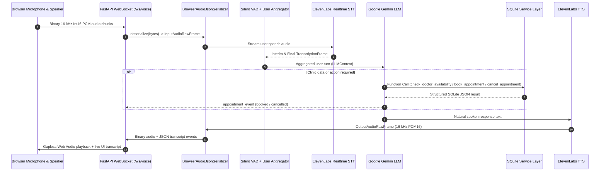

# Voice AI Pipeline Description

This document describes the real-time voice processing pipeline powering **Maya**, the AI medical receptionist in the **Voice AI Doctor Appointment Assistant**.

---

## End-to-End Flow

```text
Microphone → Browser Web Audio (16 kHz PCM16) → FastAPI WebSocket (/ws/voice)
  → Silero VAD → ElevenLabs Realtime STT → Google Gemini LLM (+ Function Calling)
  → SQLite Service Layer → ElevenLabs TTS → FastAPI WebSocket → Browser Speaker
```



---

## Stage-by-Stage Breakdown

### 1. Browser Microphone Capture (`frontend/src/utils/audio.ts`, `useVoiceAssistant.ts`)
- Requests microphone access via `navigator.mediaDevices.getUserMedia` with echo cancellation, noise suppression, and auto gain control enabled.
- Captures Float32 audio frames using `AudioWorkletNode` (`mic-capture-processor`, with automatic `ScriptProcessorNode` fallback).
- Downsamples from the browser's hardware rate (e.g., `48 kHz`) to **`16,000 Hz` mono signed 16-bit little-endian PCM** (`downsampleFloat32ToInt16Pcm`) and streams binary WebSocket messages when unmuted.

### 2. Transport & Frame Serialization (`backend/app/routes/voice.py`, `backend/app/voice/serializer.py`)
- FastAPI accepts WebSocket connections at `/ws/voice`, validates `GEMINI_API_KEY`, `ELEVENLABS_API_KEY`, and `ELEVENLABS_VOICE_ID`, and instantiates `FastAPIWebsocketTransport`.
- `BrowserAudioJsonSerializer` converts:
  - Incoming `bytes` → `InputAudioRawFrame(sample_rate=16000, num_channels=1)`
  - Incoming JSON `str` → `InputTransportMessageFrame`
  - Outgoing `OutputAudioRawFrame` → `bytes`
  - Outgoing `OutputTransportMessageUrgentFrame`, `InterruptionFrame`, and `ErrorFrame` → JSON `str`

### 3. Voice Activity Detection & Speech-to-Text (`SileroVADAnalyzer` + `ElevenLabsRealtimeSTTService`)
- `SileroVADAnalyzer` (`VADParams(stop_secs=0.6)`) runs inside `LLMUserAggregatorParams` to detect when the caller starts and stops speaking, enabling automatic turn boundaries and user barge-in interruptions.
- `ElevenLabsRealtimeSTTService` (`CommitStrategy.MANUAL`, `scribe_v2_realtime`) streams audio to ElevenLabs over WebSocket and emits `InterimTranscriptionFrame` and `TranscriptionFrame`.
- `UserTranscriptBridge` (`TranscriptBridgeProcessor`) forwards live VAD and STT transcript events to the frontend so the caller sees real-time speech transcription.

### 4. Conversational Reasoning & Function Calling (`GoogleLLMService` + `app/ai/tools.py`)
- `GoogleLLMService` (`gemini-2.5-flash`, `temperature=0.2`) receives the conversation history from `LLMContext`, anchored by `build_system_prompt()`.
- Three functions are registered via `ToolsSchema` and `llm.register_function(...)`:
  1. **`check_doctor_availability(doctor_name, speciality, appointment_date)`**: Queries SQLite via `doctor_service` for matching doctors and open slots.
  2. **`book_appointment(caller_phone, doctor_id, appointment_date, appointment_time, phone_confirmed)`**: Enforces phone confirmation (`phone_confirmed=True`), validates string phone numbers (preserving leading zeros and `+`), atomically claims the slot in SQLite, and inserts the appointment.
  3. **`cancel_appointment(caller_phone, appointment_id, phone_confirmed, cancellation_confirmed)`**: Enforces phone confirmation, retrieves active bookings for that phone number, prompts selection when multiple active bookings exist, requires explicit `cancellation_confirmed=True`, cancels the appointment, and releases the slot back to `available`.
- When a booking or cancellation succeeds, `register_voice_tools` pushes an `appointment_event` JSON frame over `/ws/voice` so the React dashboard refreshes KPIs, availability, and confirmation cards immediately.

### 5. Text-to-Speech & Speaker Playback (`ElevenLabsTTSService` + Web Audio API)
- `AssistantTranscriptBridge` streams Gemini's text reply to the frontend transcript console while `ElevenLabsTTSService` (`eleven_turbo_v2_5`, `sample_rate=16000`) synthesizes natural speech audio.
- Outgoing PCM16 audio bytes travel back over `/ws/voice` to the browser, where `useVoiceAssistant.ts` converts Int16 samples to Float32 `AudioBuffer`s and schedules gapless sequential playback via `AudioBufferSourceNode`.
- If the caller interrupts mid-sentence, `InterruptionFrame` immediately stops queued browser playback nodes.
- Ending the call stops all `MediaStreamTrack`s, closes `AudioContext`, and closes the WebSocket cleanly.
