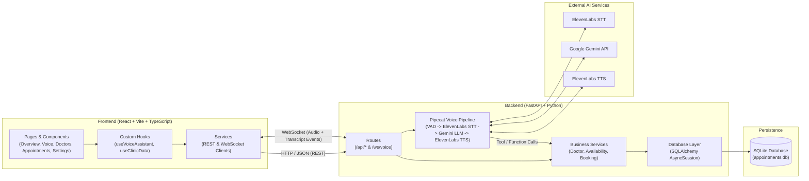

# Project Architecture — Voice AI Doctor Appointment Assistant

## 1. Architectural Overview

The **Voice AI Doctor Appointment Assistant** is structured as a decoupled full-stack application separating:

1. **Presentation Layer (`frontend/`)** — A React + TypeScript SPA built with Vite, Tailwind CSS, Lucide React, and Framer Motion.
2. **API & Orchestration Layer (`backend/app/`)** — A FastAPI application exposing REST endpoints for dashboard data and WebSocket transport endpoints for real-time voice sessions.
3. **Voice AI Pipeline (`backend/app/voice/`)** — A Pipecat-orchestrated real-time audio pipeline combining Voice Activity Detection (VAD), ElevenLabs STT, Google Gemini LLM with function calling, and ElevenLabs TTS.
4. **Persistence Layer (`backend/app/db/` & `backend/app/models/`)** — An asynchronous SQLite database accessed through SQLAlchemy 2.0 (`aiosqlite`) for storing doctors, schedules/time slots, appointments, and call transcripts/sessions.

---

## 2. High-Level System Diagram

---

## 3. Component Responsibilities

### 3.1 Frontend (`frontend/src/`)
- **`pages/`**: Top-level views (e.g., main clinical scheduling dashboard and call workspace).
- **`components/`**: Focused, reusable UI components (doctor cards, slot selectors, appointment tables, live call modal, transcript stream, status badges).
- **`hooks/`**: Encapsulates browser microphone capture (`AudioContext` + `AudioWorkletNode`), WebSocket lifecycle management (`useVoiceAssistant`), call timer state, and backend API synchronization (`useClinicData`).
- **`services/`**: Typed HTTP clients (`fetch`) for REST APIs and WebSocket connection helpers.
- **`types/`**: Shared TypeScript interfaces mirroring backend Pydantic schemas.
- **`assets/`**: Static branding assets.

### 3.2 Backend (`backend/app/`)
- **`core/config.py` & `core/exceptions.py`**: Environment-driven configuration via `pydantic-settings` and domain exceptions.
- **`routes/`**: Thin HTTP and WebSocket transport controllers (`/api/*` and `/ws/voice`).
- **`schemas/`**: Pydantic v2 request/response DTOs defining strict API contracts and phone number validation.
- **`models/`**: SQLAlchemy ORM table definitions (`Doctor`, `Slot`, `Appointment`).
- **`db/database.py` & `db/seed.py`**: Async SQLAlchemy engine (`PRAGMA foreign_keys=ON`), `AsyncSessionLocal`, `get_db`, and idempotent seeding.
- **`services/`**: Pure domain/business logic (`doctor_service`, `appointment_service`, `dashboard_service`). Both REST routes and AI tools call the **same service layer**.
- **`ai/`**: Gemini system prompt (`prompts.py`), standalone SQLite-backed tool functions (`tools.py`), and Gemini orchestrator (`gemini_assistant.py`).
- **`voice/`**: Pipecat 1.17.0 pipeline assembly (`pipeline.py`), Silero VAD, `BrowserAudioJsonSerializer` (`serializer.py`), `TranscriptBridgeProcessor` (`processors.py`), and Pipecat tool registrations (`tools.py`).

---

## 4. Communication Flows

### 4.1 Dashboard Data & Manual Actions (REST over HTTP)
1. The React frontend calls `backend/app/routes/` via `frontend/src/services/api.ts` using JSON over HTTP (`VITE_API_BASE_URL`).
2. FastAPI validates incoming payloads with Pydantic schemas (`schemas/`), resolves an `AsyncSession` via `get_db()`, and delegates to `services/`.
3. Services query or update SQLite inside transactions and return domain records serialized back to JSON.

### 4.2 Real-Time Voice Call Flow (WebSocket + Pipecat)
1. **Session Initiation:** The frontend opens a bidirectional WebSocket connection to `/ws/voice` when the user starts a call.
2. **Upstream Audio:** Browser microphone audio frames stream over the WebSocket into Pipecat's input transport.
3. **Speech Recognition (STT):** VAD segments speech turns and forwards audio to **ElevenLabs STT**, producing live user transcripts.
4. **Reasoning & Tool Execution (LLM):** Transcripts enter **Google Gemini** via Pipecat's LLM service with registered function tools (`check_doctor_availability`, `book_appointment`, `cancel_appointment`).
5. **Database Mutation:** When Gemini invokes a tool, the handler executes the corresponding function in `app/services/` against SQLite and feeds the structured result back to Gemini.
6. **Speech Synthesis (TTS):** Gemini's natural-language response streams into **ElevenLabs TTS**, returning synthesized audio frames over the WebSocket to the browser while simultaneously pushing transcript/event frames so the UI stays in sync.
7. **Dashboard Sync:** After appointment mutations (booking or cancellation), the frontend receives state updates (or invalidates/refreshes queries) so the doctor availability and appointments views reflect changes immediately.

---

## 5. Scalability & Maintainability Decisions

- **Shared Service Layer:** REST routes and Voice AI function tools share identical service functions, guaranteeing consistent validation and transactional integrity in SQLite.
- **Async I/O End-to-End:** FastAPI, `aiosqlite`, Pipecat, and external API clients operate asynchronously so concurrent calls and dashboard requests do not block the event loop.
- **Database Portability:** Using SQLAlchemy 2.0 ORM with `DATABASE_URL` allows migrating from SQLite to PostgreSQL later by changing the connection string and driver without rewriting domain logic.
- **Strict Boundary Contracts:** Pydantic v2 schemas on the backend and TypeScript interfaces on the frontend isolate internal DB representations from external API payloads.
